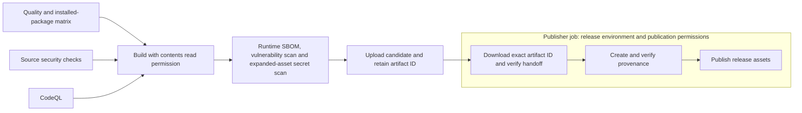

# Release qualification and publication gates

The release workflow now qualifies the exact tagged candidate before it can
publish. These changes implement repository controls; they do not establish
that hosted CI, attestation verification or organizational approval has run.
Enterprise readiness remains NOT ASSESSED.

The production CLI snapshot-input follow-up rejects plaintext transport,
TLS-verification bypass and ambiguous RKE2 S3 env-file input before inventory
creation or Ansible invocation. The local suite covers literal values,
duplicate/malformed/implicit entries and confidential diagnostics; a pinned
real kubectl client independently exercises env-file behavior. See the
[operating contract](operations.md#operating-requirements) and
[current execution status](enterprise-readiness-status.md). This provides
input-validation evidence only. The shared direct-Ansible gate is qualified
locally below; actual remote execution, object-store security, off-host backup
success and restore qualification remain separate obligations.

The user confirmed the new 100-control enterprise framework as this active
goal's acceptance basis on 2026-11-03. That selects the assessment contract;
it does not supply a frozen deployment scope, operating objectives or production
approval.

## Real Kubernetes API gate — 2026-11-03

GitHub and GitLab CI require `scripts/check-snapshot-api.py` on both pinned
Ansible profiles. It executes the actual snapshot task block against upstream
Kubernetes **v1.36.5** and etcd **v3.6.8** in temporary loopback-only processes.
The API version must match both configured distribution patches. The etcd
selection follows the [upstream patch's dependency declaration](https://github.com/kubernetes/kubernetes/blob/v1.36.5/build/dependencies.yaml).
This follows the [isolated API testing approach](https://book.kubebuilder.io/reference/envtest.html);
the fixture has no worker nodes, scheduler or kube-controller-manager.

Thirteen observations qualify create/repeat, rotation, owned-field removal,
foreign metadata, same-manager drift, foreign ownership conflict, immutable
Secret rejection, denied RBAC, check mode, an actual enforcing admission policy,
fixture storage encryption and terminal process cleanup. Metadata audit binds
the actual requests and confirms that unchanged/rejected operations do not
attempt persistent apply. Both API and etcd use mutual TLS with synthetic
certificates, and audit records exclude Secret bodies. The storage observation
uses a fixture-owned encryption provider and ephemeral key; production
encryption, key custody/rotation and distribution configuration require their
own acceptance. Real distribution runtime, remote privilege, workers, issuer
lifecycle, object storage, backup/restore and operational objectives remain open.

The first native probe exposed an incorrect fixture expectation: actual
ValidatingAdmissionPolicy denial returns HTTP 422 with its policy/message.
The corrected oracle requires that exact response and verifies no persistence.
The original failure, metadata audit and terminal-process receipt are retained.

## Snapshot Secret reconciliation gate — 2026-11-03

GitHub and GitLab CI require `scripts/check-snapshot-reconcile.py` on both
pinned Ansible profiles. It qualifies the actual Secret task block with the
real pinned client and an authenticated localhost HTTPS API model. Seventeen
scenarios cover repeat runs, rotation, removal, drift, metadata preservation,
read/diff/apply failures, rejected trust/authentication, check mode, external
diff overrides, stale staging/allocation failures and two actual interleaved
Ansible processes. The source guard also requires private invocation staging,
bounded server-side comparison, apply only on differences, accurate persistent
change reporting and cleanup of only the allocated directory. Twenty-three
new source mutations and three CI mutations protect those requirements.
The model qualifies controller/client behavior; actual Kubernetes ownership,
admission/conflicts, same-object concurrent writers, remote privilege and the
approved production profile still need staging acceptance. See the
[operating contract](operations.md#operating-requirements).

## Managed fleet strategy gate — 2026-11-03

GitHub and GitLab CI require `scripts/check-managed-strategy.py` on both pinned
Ansible profiles. Its source guard requires the literal built-in linear strategy
and fatal fleet errors on all fourteen managed deploy/upgrade plays. Mutation
tests cover every play and removed or conditional CI execution. The native fixture
uses three playbooks, three environment strategy settings and healthy/preflight/
health outcomes: 27 cases per Core. Source targets, serial settings and failure
policy are preserved; host/service changes are represented by local markers.
The pre-fix reproduction is retained because a failing command alone did not
prove safe progression: `free` and `host_pinned` advanced later phases after a
peer failed. See the [operating contract](operations.md#managed-cluster-reconciliation-and-upgrade-health)
and [current checkpoint](enterprise-readiness-status.md). Live host transitions,
availability, quorum safety and independently accepted staging remain required.

## Native production snapshot gate — 2026-11-03

GitHub and GitLab CI now require `scripts/check-snapshot-config.py` on both
pinned Ansible profiles. The guard rejects a removed or conditional GitHub gate
and a removed GitLab gate. The shared CLI/controller validator requires bounded,
literal production input before fleet/host/add-on changes, with exact transfer
binding and check-mode publication skip. Thirty-five native cases per Core,
plus selected-tag and two-host fleet exercises, qualify the local behavior.
The corrected 65,535-byte raw-line bound prevents the real client's observed
silent credential omission; failures and the corrected run are retained.
The 127-resource package includes the new role and matching validator module.
See [current execution evidence](enterprise-readiness-status.md) and the
[operating contract](operations.md#operating-requirements). Actual scheduled
off-host backup, custody/encryption, object-store trust, restore, hosted execution
and independent acceptance remain separate requirements.

## GitHub job and permission boundaries

### Protected check names and matrix completion

The authenticated read-only `main` protection view on 2026-11-03 requires
`CI / test`, `Security / scan`, and `CodeQL / Analyze Python` from GitHub
Actions, plus the separate `CodeQL` and `Trivy` checks from GitHub Advanced
Security. The local workflow jobs now preserve those first three exact names.
This observation is retained in the private acceptance-audit receipt; it is
not an approval or evidence that the current candidate ran on GitHub.

`CI / test` is an unprivileged aggregate of the entire `test` and
`installed-package` matrices. It runs with `always()` so failed, cancelled or
skipped prerequisites cannot silently omit the required check. Its first step
exits with failure unless both dependency results are `success`; it has no
checkout, incoming artifacts, token permissions or allowed-failure override.
The actual test/package jobs retain their original execution and failure
contracts. The release build still requires all called workflows to succeed.
The source guard and fourteen adverse mutations protect the aggregate's
dependencies, condition, failure exit, privilege and exact check names.

Public provider state initially observed on 2026-11-03 reported Security and
CodeQL as `disabled_inactivity`. After explicit user approval, both workflows
were enabled and a fresh public API receipt independently confirmed `active`.
Their prior successful runs and the existing open PR refer to older commits.
Executing all five protected checks with the configured provider applications
on the final committed candidate and independently accepting those results
remain required. The protection rule has not been changed or weakened.



`quality`, `security` and `codeql` call the repository's workflows through
relative paths, so they use the caller's commit. All must succeed before the
read-only `build` job. The publisher depends on that build; no `always()` or
allowed-failure override can substitute for successful qualification. The
same-commit call mechanism follows [GitHub's reusable workflow contract](https://docs.github.com/en/actions/how-tos/reuse-automations/reuse-workflows).

Only the publisher receives repository publication and signing permissions.
SBOM generation and artifact checks run through the shared qualification
routine with pinned CLI tools. The single candidate artifact upload happens
after that routine succeeds. The publisher selects the build's artifact ID and uses
the download action's hard-failure digest policy, then validates checksums and
identity again. No release or external message was sent during local testing.

The `release` environment name is configured in YAML. **Its required reviewers,
tag restrictions and other protection settings must still be configured and
verified by the repository owner.** Naming an environment does not prove that
human approval is required. Organization-owned repositories also need their
Gitleaks Action license secret; it is passed explicitly to the reusable
security workflow. PR commenting is disabled. See the [upstream action's
environment-variable contract](https://github.com/gitleaks/gitleaks-action/blob/e0c47f4f8be36e29cdc102c57e68cb5cbf0e8d1e/README.md).

## Shared artifact qualification

Package creation now uses the [exact-source build and reconstruction contract](reproducible-packages.md).
The builder requires a clean expected commit and matching locked tools, derives
archive timestamps from that commit, and verifies payload-preserving metadata
normalization. A second build in a fresh local clone and separately provisioned
hash-locked environment must produce identical wheel and compressed-sdist bytes.
Both CI channels require that check before common artifact qualification.

Both CI systems invoke the same command after creating the wheel, sdist and
repository tar/ZIP:

```sh
python scripts/qualify-release.py dist --tag "$RELEASE_TAG" --commit "$EXPECTED_COMMIT"
```

The routine requires a clean source checkout at the expected full commit and
exactly four fresh regular input archives. It then:

1. Verifies candidate-bound exact-source build/reconstruction receipts, then
   verifies the Trivy and Syft tool pins before use.
2. Installs the candidate wheel and resolved runtime dependencies into a new
   isolated directory, using wheels only, and records pip's installation report.
3. Generates a CycloneDX runtime SBOM.
4. Qualifies the actual secret scanner with clean and seeded archive controls.
5. Expands candidate archives under bounded, protected inspection storage.
6. Runs post-build Python vulnerability scanning with a fresh database cache
   and scans expanded artifacts for secrets at all severities.
7. Reconciles installed Python metadata, SBOM and vulnerability-scan inventories,
   rejects blocking or incomplete reports, writes exact checksums, and validates
   the final artifact handoff.

Every failure prevents a passing summary. The status
`ARTIFACT_CHECKS_PASSED_NOT_PRODUCTION_APPROVAL` deliberately describes artifact
checks, not an organizational release decision. Logs and original scan reports
stay under the restricted `.certweaver/release-qualification` work directory;
they are not part of the published `dist` payload. The derived evidence record
described below is retained separately with the candidate. Existing work directories or
stale/extra input artifacts are refused rather than silently overwritten.

`ci/tools.lock.json` freezes official release URLs, archive hashes and extracted
executable hashes for Trivy 0.76.1 and Syft 1.56.0. Archive hashes were checked
against the publishers' release metadata before deriving executable hashes.
`scripts/install-ci-tool.py` checks these identities for online/offline acquisition,
rejects links or unexpected members, and verifies cached executable bytes before
reuse. Receipts distinguish an archive checked this run from cached executable
verification. The implementation has separate compressed-download, executable
and expanded-inspection limits; the verified Trivy executable is about 176 MB.
Maintainers still need to approve the source trust decisions. These hashes are
not a claim of upstream signature verification or organizational approval.

The same lock includes Helm 3.21.2, Cosign 3.1.4, kube-apiserver 1.36.5 and
etcd 3.6.8. The API binary matched its official SHA-256 endpoint; the etcd
archive matched the digest in the publisher's release metadata before its
member digest was derived. Both new identities require exact release paths,
formats and members, bounded verified acquisition, and verified cached bytes.
The existing four records, legacy allow expression, extraction, redirect and
size/cache enforcement remain identical for their earlier tool identities.

The current CI tool lock supports Linux/amd64. This limits the qualification
runner profile, not the CLI's advertised deployment targets. Other runner
architectures require their own approved pins and qualification.

## Qualification evidence handoff and database freshness

The shared routine must successfully export `release-evidence/qualification.json`
before it writes a passing summary. The record binds the full source commit and
tag, every candidate artifact (including `SHA256SUMS`), tool identities and receipt
hashes, qualification scripts and policy files, original report hashes, reconciled
runtime inventory and the archive/scanner control results. It also records the
vulnerability database bytes' SHA-256 and the original metadata file's SHA-256.

The record's status is `DERIVED_QUALIFICATION_EVIDENCE_NOT_PRODUCTION_APPROVAL`.
It additionally retains the build/reconstruction receipt hashes and selected
reconstruction facts, including the expected source commit, epoch and exact
package hashes. Publisher verification rejects a package/reconstruction mismatch.
Its fields are explicitly selected: process output, pip download URLs, environment
values, secret match contents, runner paths and arbitrary report fields are not
copied into it. Tests seed canaries into omitted fields and require their absence
from the exported record. Raw reports remain in the restricted work directory;
**hashes and selected facts do not replace protected retention of originals**.
An approved original-evidence storage and retention arrangement remains required.

The repository's database freshness guard currently requires schema 2, aware
timestamps, a download during this qualification run (five minutes of clock
tolerance), an update age of at most 24 hours and an unexpired `NextUpdate`.
It rejects missing/empty/linked database inputs and contradictory chronology.
The upstream metadata exposes `Version`, `UpdatedAt`, `DownloadedAt` and
`NextUpdate`; see [Trivy's database metadata contract](https://pkg.go.dev/github.com/aquasecurity/trivy-db/pkg/metadata).
These are repository checks awaiting release-owner approval, not a claimed
enterprise service objective or upstream database signature verification. The
database hash records identity; the full database is not retained in the bundle.

GitHub transfers `dist/*` and this one evidence file together through the exact
build artifact ID into `.certweaver/release-handoff`. Downloaded content remains
outside the publisher's checked-out verification scripts; the verification steps
invoke those trusted scripts by their absolute workspace paths. The publisher
verifies the artifact and policy hashes, expected
tag/commit and current database freshness **before** creating provenance. It
attests and verifies both release assets and the evidence record, then publishes
only `dist/*`. An approval wait that outlives database freshness fails publication;
the candidate must be qualified again with current evidence. The artifact expires
after seven days. GitHub artifact visibility follows repository permissions and
does not provide a Maintainer-only evidence vault; the derived record is designed
for that visibility. Hosted execution and access-policy review remain outstanding.

GitLab independently invokes the same evidence verifier and retains the derived
record with successful candidate artifacts under its configured Maintainer/Owner
artifact access. Its signing and consumer-verification gaps below remain open.
Neither platform uploads the raw qualification work directory or scanner logs.

## Artifact identity and provenance

`scripts/check-release.py` checks source/tag identity with ordinary runtime
conditions rather than Python assertions that optimization could disable.
Full handoff qualification additionally requires:

- A clean Git checkout at the expected full source commit.
- Exactly one expected wheel, sdist, repository tar, repository ZIP, runtime
  CycloneDX SBOM and checksum manifest; no extra, missing, empty or linked files.
- Exactly one checksum entry for each payload, with no path traversal,
  duplicate entries or mismatched bytes.
- Wheel/sdist package name and version matching the source module, package
  configuration and release tag.
- Git archive commit markers and archive prefixes matching the expected source
  commit and tag. Real Git tar/ZIP format probes confirmed these markers.
- A usable basic CycloneDX component inventory. This is a presence/shape check,
  not proof of complete licensing, dependency coverage or SBOM semantics.

The publisher creates provenance and verifies every release file with the
expected repository, signer workflow and source digest before publication.
The restrictions use the [official GitHub CLI verification interface](https://cli.github.com/manual/gh_attestation_verify).
Checksums alone do not authenticate a release. Consumers must independently
verify provenance against their approved repository, workflow and source
commit; using values taken only from the downloaded candidate is insufficient.

Example consumer verification, after independently determining EXPECTED_COMMIT:

```sh
gh attestation verify certweaver-0.1.0-py3-none-any.whl \
  --repo Yunushan/certweaver \
  --signer-workflow Yunushan/certweaver/.github/workflows/release.yml \
  --source-digest "$EXPECTED_COMMIT"
```

The local checkout is uncommitted. A real invocation against its current HEAD
correctly denied full qualification. Passing artifact fixtures in the test
suite use an explicit test checkout double and are not release evidence.
No hybrid candidate combining current dirty-tree code with old HEAD archives
was treated as a qualified release.

## Archive secret inspection

A real Trivy 0.76.1 fixture test exposed an important coverage boundary:

| Input containing the same harmless generated private-key fixture | Scanner result |
|---|---|
| Plain file | Exit 1; one detected secret |
| Compressed wheel, ZIP and tar assets | Exit 0; zero detected secrets |
| The three archives after bounded expansion, PEM fixtures | Exit 1; three detected secrets |
| Current locked policy, PEM and Markdown fixtures in each archive | Exit 1; six detected secrets |

The scanner binary's archive digest was checked against its official release
digest before the final probe. Only counts and exit status were retained;
temporary fixture keys were not deployed or retained as operational evidence.

The release workflow therefore runs `scripts/expand-release-assets.py` before
the artifact secret scan. It copies and recursively expands assets without
executing them, refuses a preexisting destination, and rejects parent/absolute/
drive-qualified paths, links and special files, duplicate members, corrupt
archives, excessive nesting, excessive member counts and excessive expanded
bytes. Defaults are 256 MiB, 20,000 members and three archive levels. The secret
scan covers the expanded directory at all severities and fails the build on
findings. Failed expansion also prevents scanning/upload/publication.

`scripts/check-secret-scanner.py` is versioned and mandatory in the shared
routine. A clean control must return exit 0 with no findings; all six seeded
targets must return exit 1 with exactly the expected target coverage. Missing,
malformed, partial or contradictory reports, timeouts, unavailable scanners and
always-success/always-failure implementations cannot qualify. Fixture contents
and raw scanner output are not printed, and temporary fixtures are removed.

`ci/secret-scan.yaml` disables the scanner's built-in Markdown exclusion. The
routine supplies controlled configuration and an empty ignore file and clears
scanner environment overrides. The fixture harness uses the same secret policy.
This makes its tested behavior explicit; it is not a guarantee of detecting
every possible secret class. See the [upstream configuration contract](https://trivy.dev/docs/latest/scanner/secret/).

The candidate wheel is separately installed into an isolated target directory
for runtime dependency inventory and HIGH/CRITICAL vulnerability scanning.
The real probe found that `trivy fs` over the installed target returned exit 0
while detecting **zero Python packages**. The corrected `trivy rootfs` command
detected all seven installed packages. This follows the scanner's distinction
between [pre-build projects and installed package metadata](https://trivy.dev/docs/v0.69/guide/coverage/language/).

The shared routine now requires exact agreement between installed distribution
names/versions, Python components in the SBOM and packages in the Trivy report.
An empty or partial vulnerability scan cannot pass on exit status alone. The
earlier real probe and isolated integration reported zero HIGH/CRITICAL findings
for the seven resolved Python packages, using a freshly downloaded database.
This result covers that runtime and observation time, not every deployment
component, host package or future dependency resolution.

The earlier probe above used declared ranges. The candidate qualifier now
enforces the source-bound runtime hash lock plus the candidate wheel's explicit
hash. Python 3.11/3.12 include the additional conditional `typing-extensions`
dependency; Python 3.13/3.14 do not. See [Python dependency qualification](python-dependencies.md)
for the runtime, build and development profiles, pinned pip bootstrap, disabled
configuration overrides and build-dependency resolution, and required review.
The evidence handoff binds all locks and their input manifest to the candidate.
Maintainer approval, licensing/lifecycle review and the broader deployment
dependency inventory remain outstanding.

The clean locked Python 3.11 integration reconciled all eight runtime packages,
reported no HIGH/CRITICAL vulnerabilities at observation time, passed the actual
secret scanner's clean/seeded controls and verified the isolated handoff. A real
pip installation with a deliberately altered candidate wheel hash failed with
the expected SHA-256 mismatch. These are synthetic local fixture results, not a
hosted release or assurance for all deployment components. The current evidence
manifest is `.certweaver/dependency-locks-20261103/verification-summary.json`.

## GitLab scope

The Python 3.11 and 3.14 base images and Gitleaks 8.30.1 image are now pinned to
registry manifest digests. The manifest bytes were hashed and matched their
registry digest headers. The secret job fetches full history, scans both Git
history and files, and redacts output. Tag packaging now validates module,
package and tag version identity before building.

GitLab packaging retains prior-stage success dependencies and now runs the same
artifact qualifier as GitHub before retaining candidate artifacts. Retention is
limited to successful jobs, seven days and Maintainer/Owner UI/API access.
The `maintainer` artifact-access option requires GitLab 18.4 or later. Job-token
access also depends on project visibility/allowlist settings and must be reviewed
separately. See [GitLab's artifact access contract](https://docs.gitlab.com/ci/yaml/#artifactsaccess).

GitLab.com now has a source/lock scan, protected-job OIDC authentication, exact
signed provenance and a consumer that obtains verification code from a separate
expected-commit checkout. See the [GitLab release policy](gitlab-release.md) for
the trust profile, checks and deliberate qualification boundaries. Actual hosted
execution, approved protection/runner settings, complete SAST, durable versioned
publication and independent acceptance remain open. The implementation and local
checks do not grant an authorized production decision.

## Local verification and remaining qualification

The final local suites passed on Windows Python 3.12.14 and Linux Python 3.14.4.
They include 92 release handoff/workflow cases, 17 archive expansion cases,
16 CI-tool acquisition cases, 19 shared-pipeline cases, 36 evidence-record cases,
20 Python-lock cases, 30 build/normalization/reconstruction cases and 12
scanner-oracle cases, plus 84 adapter acquisition/configuration/source-guard
cases, 35 Git acquisition/verifier cases and 24 chart acquisition/configuration
cases, plus 26 cluster health/client/guard cases and 42 distribution-version
validation/source-guard cases. The current source has 661 tests:
all pass on Linux Python 3.11 and 3.14; Windows Python 3.12 has 657 passes and
four platform-specific skips.
These full suites used hash-locked development environments and the same frozen
source snapshot. The preceding dependency-lock checkpoint separately verified
391 cases on Python 3.11 and the build/sdist-rebuild matrix on 3.11–3.14.
The current exact-source builder additionally passed real wheel smoke and a
fresh-clone/fresh-locked-environment reconstruction on Python 3.11.18, 3.12.16,
3.13.18 and 3.14.4. Both wheel and compressed-sdist hashes matched across all
four versions for the same synthetic commit. This replaces the earlier
timestamp-varying sdist result; approved production inputs and independent
acceptance remain outstanding.
The evidence handoff extends the suite with database chronology/freshness,
report privacy, receipt/hash validation, retained-SBOM substitution and isolated
publisher-verifier tests. The current results and source/report bindings are
retained under `.certweaver/running-identity-20261103/attempt-1/` and reflected in the
[enterprise status report](enterprise-readiness-status.md).
Runtime line coverage is 92.969334% on Windows/Linux 3.11 and 93.044129% on
Linux 3.14; branch coverage is 87.537538% on all three, and the exact 90%/85%
policy passed.
Actionlint 1.7.12, Ruff, YAML
lint, the workflow contract and whitespace checks passed. Ansible production
lint and all eight syntax invocations passed again with each of the newly locked
Core 2.19 and 2.21 environments; no target hosts were contacted.
Each Ansible environment also passed all nine temporary localhost HTTPS
acquisition cases with TLS validation enabled. The source acquisition guard
and HTTPS gate now run unconditionally in both GitHub and GitLab quality jobs;
the workflow contract rejects their removal or conditional skipping on GitHub
and removal on GitLab. Native Windows adapter runtime behavior remains open.
Both Ansible versions also passed eighteen image-template/service-decision
cases and nine invalid-image-input cases. These use temporary files and inspect
the actual source service-state expressions without executing systemd or
containers. The new CI gate is mandatory on both channels. An existing Windows
Compose 5.6.1 parser separately preserved all five digest references, propagated
a changed input and rejected every missing input; service env-file expansion
and daemon operations were disabled. No upstream image, architecture, runtime
identity or vendor trust approval is established by those configuration checks.
The final Git fixture adds nineteen cases on each Ansible version, including
actual HTTPS clone/reuse, invalid/nonexistent/wrong-repository refs, cache-byte
verification independent of index flags/timestamps, ignored files, changed
origin, symlink/submodule refusal, synthetic installer upgrade/rollback/repair,
check mode and an untrusted CA with an inherited TLS-bypass variable. It uses
no upstream installer and grants no publisher trust approval. Earlier failures
are retained: the TLS test caught the presence-based Git environment bypass,
and installed-wheel verification caught generated bytecode inside deployment
resources. Both are corrected in the final snapshot; strict verification was
preserved rather than bypassed.

`scripts/check-release-workflows.py` runs in GitHub CI, GitLab CI and `make
lint`. It guards required same-commit checks, failure propagation, permissions,
immutable action references, bounded archive inspection, artifact-ID handoff
and the verification/publication order. It is a targeted configuration guard,
not a general shell analyzer or a substitute for actual hosted execution and
independent review. Regression fixtures reject missing gates, skipped or
nonblocking scans, early uploads, wrong handoff identity, missing provenance
checks and unsafe archive inputs.

The complete shared routine also passed in a fresh, isolated **synthetic Git
repository**, with a test identity and no user-repository commits or publication.
It used the real pinned tools, source build, installed-wheel smoke check, actual
Git archive commit markers, scanner controls, inventory reconciliation, fresh
vulnerability database and final handoff validation. Its fixture commit and
artifact hashes are explicitly marked synthetic. They are implementation
integration evidence, not an actual proposed release or a service readiness
assessment. Earlier failed input-access and empty-scan probes were retained.

Earlier local evidence is retained under `.certweaver/supply-chain-20261103/`:
source snapshots; final Windows/Linux JUnit and coverage reports; actionlint
output and verified upstream release metadata; registry manifest pins;
archive-format and real dirty-checkout rejection probes; and the real scanner
before/after fixture result. These records are local candidate evidence, not
authenticated organizational assurance.

Earlier evidence is under `.certweaver/qualification-20261103/`: final Windows
and Linux test/coverage outputs; source snapshots; tool lock preparation; the
empty filesystem-mode report and corrected rootfs report; scanner qualification;
and `synthetic-integration-final.json` with the actual isolated integration result.

Before these controls can receive assured credit, an authorized maintainer must
provide the immutable approved candidate, execute the hosted quality/security/
artifact/provenance path, verify environment/tag/identity protections, review
findings and licenses, qualify consumer rejection cases for substituted
artifact/source/signer, and approve the resulting current evidence. The staging,
operational and independent-review requirements in the
[enterprise status report](enterprise-readiness-status.md) also remain open.

## Maintained-baseline checkpoint — 2026-11-03

The latest frozen source includes the updated distribution/cert-manager example
pins, exact-tag installer defaults, ingress ownership guards and five-chart
offline compatibility gate described in [platform-baseline.md](platform-baseline.md).
Its complete local verification, fresh-environment Python 3.11–3.14 byte-identical
package reconstruction, real artifact qualifier/handoff and exact digest-negative
probe passed. Evidence is retained in ignored
`.certweaver/maintained-baseline-20261103/attempt-4/verification-summary.json`.
This is a synthetic local candidate; hosted CI, final release/input acceptance,
consumer provenance qualification and independent production approval remain open.

## Source-security failure diagnostics — 2026-11-03

The source/lock gate now emits fixed stage and failure-category diagnostics,
numeric scanner exits and an explicit unavailable-advisory-extraction state.
Malformed/missing reports do not suppress the redacted failure record. Captured
scanner output is retained privately on nonzero exits and timeouts; diagnostic
write failure remains a failed gate, and existing evidence is never overwritten.
Raw matches are outside the GitLab artifact allowlist. Approved protected
storage for original hosted evidence remains an owner requirement.

The current local fixture caught a dependency-scan ENOSPC error. Its private
log survived the new local finally-retention path. A same-commit rerun used an
owned disk-backed temporary workspace instead of the 3.9 GiB `/tmp` memory
filesystem, and passed without policy/system changes. Five real adverse CLI
cases and timeout/malformed-report unit cases qualify the failure paths. The
older unretained ValueError remains unexplained. See the current
[enterprise execution status](enterprise-readiness-status.md) for source/report
bindings, fresh suites and the explicit historical Ansible/crypto evidence scope.

## Managed rolling preparation — 2026-11-03

The managed RKE2/K3s playbooks now keep preparation, optional load-balancer
reconciliation, server work, pending handlers and final readiness in one serial
host sequence. A per-host version/changing-runtime precheck runs before
preparation. The source guard rejects a separate preparation play, parallel
batches, reordered roles, bypassed prechecks and missing/late handler barriers.
Both pinned Ansible profiles locally pass 74 version and 60 health/progression
cases, including three-node positive and adverse preparation/handler/health
paths. CI commands remain mandatory and unchanged; actual hosted execution is
still required. See the [operating contract](operations.md#managed-cluster-reconciliation-and-upgrade-health)
and [current evidence status](enterprise-readiness-status.md). Synthetic markers
do not demonstrate real OS/service changes, workload eviction, quorum safety,
backup/restore or approved availability budgets.

## Private administrative kubeconfig export — 2026-11-03

GitHub and GitLab CI now require the actual synthetic export fixture. The
workflow guard rejects a removed or conditional GitHub gate and a removed
GitLab gate. Both pinned Core versions passed 23 observations with protected
synthetic files, exact bytes, rotation/idempotence, check mode and adverse
path/logging cases. The final 878-case suites and 125-resource package matrix
passed after a missing sdist manifest entry set was corrected; failed attempts
remain retained. See the [current evidence status](enterprise-readiness-status.md)
and [export/migration contract](operations.md#optional-administrative-kubeconfig-export).
Root-controller fixtures do not qualify actual remote SSH/become, credential
rotation policy, hosted execution or independent release/production approval.

## Managed operator endpoint qualification — 2026-11-03

The mandatory private-export CI command now also executes actual managed
operator preparation and real pinned-client TLS/authentication cases. Both Core
profiles pass 23 export and 22 endpoint observations; nineteen additional source
mutations reject targeting, trust/logging, publication and cleanup regressions.
The endpoint is configured through the selected context's cluster, using private
staging and atomic publication. Rejected preparation preserves the prior file;
unchanged full-path preparation/export reports zero changes.

Synthetic route and named-order comparison corrections preserve the exact token
check and all named fields. A subsequent staged postcondition caught the client's
TLS-name clearing behavior; the final role explicitly preserves that name and
rejects source/destination identity aliases. Failed checks and real-client
reproductions remain retained. Current source, tests, full package matrix,
real scanners and native results are bound in the
[execution status](enterprise-readiness-status.md). Actual VIP/cluster identity,
remote SSH/become, hosted execution and independent acceptance remain open.
